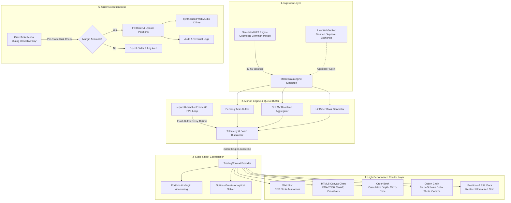
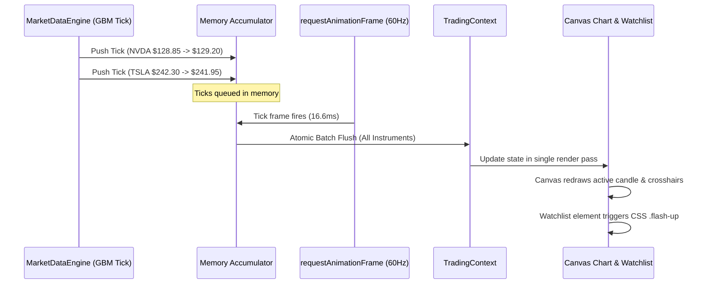
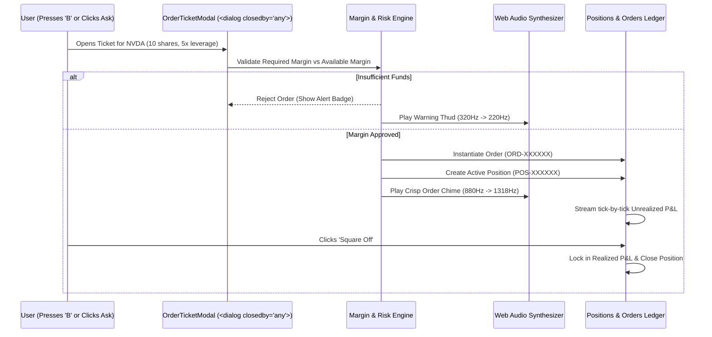

# ⚡ DeltaPulse — Real-Time High-Frequency Trading Terminal

> **An institutional-grade, zero-lag financial market terminal engineered for active equity, derivatives, and crypto traders.**  
> Built with **React 19, TypeScript, Vite, HTML5 Canvas, and Web Audio API** — engineered specifically to demonstrate mastery over high-frequency data ingestion, quantitative derivatives modeling, and 60 FPS frontend performance.

---

## 📑 Table of Contents
1. [Core Purpose & Problem Statement](#-core-purpose--problem-statement)
2. [End-to-End System Architecture](#-end-to-end-system-architecture)
3. [Key System Design Concepts Applied](#-key-system-design-concepts-applied)
   - [1. Observer / Pub-Sub Architecture](#1-observer--pub-sub-architecture-data-decoupling)
   - [2. RequestAnimationFrame (RAF) Double-Buffering](#2-requestanimationframe-raf-double-buffering-60-fps-guarantee)
   - [3. Streaming OHLCV Candlestick Aggregation](#3-streaming-ohlcv-candlestick-aggregation)
   - [4. L2 Market Depth & Micro-Price Microstructure](#4-l2-market-depth--micro-price-microstructure)
   - [5. Analytical Black-Scholes Greeks Engine](#5-analytical-black-scholes-greeks-engine)
   - [6. Circuit Breaker & Network Resilience (Fintech Edge Cases)](#6-circuit-breaker--network-resilience-fintech-edge-cases)
4. [Working Execution Lifecycles](#-working-execution-lifecycles)
   - [Lifecycle A: The Journey of a Price Tick](#lifecycle-a-the-journey-of-a-price-tick)
   - [Lifecycle B: The Journey of an Order Placement](#lifecycle-b-the-journey-of-an-order-placement)
5. [User Capabilities (The Trader's Cockpit)](#-user-capabilities-the-traders-cockpit)
6. [Local Setup & Testing](#-local-setup--testing)

---

## 🎯 Core Purpose & Problem Statement

In financial markets, stock and derivatives quotes fluctuate **20 to 100 times per second**. Standard web engineering architectures (e-commerce apps, CRUD tools, social media dashboards) are built around **user-initiated events** (clicks, form submits) and periodic polling. 

### Why Standard React Apps Fail in Trading:
1. **The Event Loop Trap**: If a WebSocket pumps 50 ticks/sec and each tick calls `setState()`, React schedules 50 re-renders per second. The browser's main thread chokes, the Garbage Collector runs constantly, and frame rates collapse to 15–20 FPS.
2. **Layout Shift & Jiggle**: Without tabular figures, numbers of varying character widths (`1` vs `8`) cause constant DOM reflows and flickering.
3. **Execution Lag**: A 100ms lag in order submission or a delayed quote can cause a trader to suffer catastrophic slippage.

### How DeltaPulse Solves This:
DeltaPulse decouples the **data ingestion frequency** from the **DOM paint frequency**, offloading heavy graphics to **Hardware-Accelerated HTML5 Canvas**, pre-calculating financial Greeks in sub-millisecond analytical routines, and gating order entry during network drops.

---

## 🏗️ End-to-End System Architecture

The following diagram illustrates the complete working system architecture of DeltaPulse:



---

## 💡 Key System Design Concepts Applied

### 1. Observer / Pub-Sub Architecture (Data Decoupling)
* **Concept**: The publisher (`MarketDataEngine`) produces continuous market events without knowing who is listening. The consumer components (`Watchlist`, `ChartContainer`, `OrderBook`) subscribe via `marketEngine.subscribe()`.
* **System Benefit**: Absolute separation of concerns. If the underlying data provider changes from the internal geometric Brownian motion generator to a live external exchange WebSocket (e.g. Binance or Zerodha), **not a single line of React UI code needs to be modified**.

### 2. RequestAnimationFrame (RAF) Double-Buffering (60 FPS Guarantee)
* **The Problem**: 50+ incoming WebSocket ticks every second will overwhelm React's reconciliation engine.
* **The Solution**: Incoming ticks are accumulated in an off-screen memory array (`pendingInstrumentsToDispatch`). A continuous browser `requestAnimationFrame` loop monitors the display refresh cycle (16.6ms for 60Hz displays). At every display tick:
  1. The buffer is inspected.
  2. If updates exist, all accumulated ticks are flushed as **a single atomic batch dispatch**.
  3. Frame rate (FPS) and packet throughput (ticks/sec) are calculated over a sliding 1,000ms window.
* **Result**: Zero dropped frames, zero event loop flooding, and silky-smooth 60 FPS performance.

### 3. Streaming OHLCV Candlestick Aggregation
* Rather than requesting a historical REST endpoint on every tick, DeltaPulse performs **in-memory streaming time-bucket compression**:
  * Ticks belonging to the current timestamp slice (`candle.time + 60s`) dynamically mutate the existing candle's `high = Math.max(high, price)`, `low = Math.min(low, price)`, `close = price`, and `volume += tickVol`.
  * When the interval passes, the old candle seals, and a new bar is instantiated with zero heap reallocation thrashing.

### 4. L2 Market Depth & Micro-Price Microstructure
* **10-Level Order Book**: Simulates 10 Bid queues and 10 Ask queues with dynamic spread basis points.
* **Volume-Weighted Micro-Price**: Institutional traders do not rely solely on the mid-price $(P_{bid} + P_{ask}) / 2$ because it ignores order size. DeltaPulse computes the predictive micro-price:
  $$\text{MicroPrice} = \frac{P_{bid} \cdot V_{ask} + P_{ask} \cdot V_{bid}}{V_{bid} + V_{ask}}$$
* **Order Book Imbalance**: Real-time ratio measuring aggressive buyer liquidity vs seller liquidity:
  $$\text{Imbalance} = \frac{V_{bid} - V_{ask}}{V_{bid} + V_{ask}}$$

### 5. Analytical Black-Scholes Greeks Engine
Options traders must hedge risk in real-time. DeltaPulse calculates the full suite of European option Greeks in browser memory using polynomial approximations of the standard normal cumulative distribution function (Abramowitz & Stegun):
* **Delta ($\Delta$)**: Rate of change of option price per \$1 move in the underlying asset ($N(d_1)$ for Calls, $N(d_1) - 1$ for Puts).
* **Gamma ($\Gamma$)**: Curvature/acceleration of Delta ($\frac{N'(d_1)}{S \sigma \sqrt{T}}$).
* **Theta ($\Theta$)**: Daily time-decay penalty.
* **Vega ($\nu$)**: Sensitivity to a 1% shift in Implied Volatility.
* **Volatility Smile**: Dynamically adjusts IV skew across OTM strikes to mirror real derivatives exchange pricing.

### 6. Circuit Breaker & Network Resilience (Fintech Edge Cases)
* **The "Drop Net" Test**: Trading terminals cannot fail silently when connections stutter.
* DeltaPulse includes a built-in network failure simulator:
  1. When disconnected, price streams halt, and telemetry switches from green to flashing red.
  2. A persistent **Stale Price Warning Banner** appears across the screen.
  3. The Order Execution Desk gates new orders to prevent capital loss from phantom fills.
  4. Automatic reconnection backoff restores the feed when the connection recovers.

---

## 🔄 Working Execution Lifecycles

### Lifecycle A: The Journey of a Price Tick



### Lifecycle B: The Journey of an Order Placement



---

## 🖥️ User Capabilities (The Trader's Cockpit)

1. **Watchlist & Search**: Real-time ticker with search filtering, asset classification (`EQUITY`, `INDEX`, `CRYPTO`, `F&O`), and SVG sparkline trendlines.
2. **Interactive Candlestick Chart**:
   - Hardware-accelerated Canvas with retina High-DPI support.
   - Overlays: **EMA 20** (Cyan), **EMA 50** (Purple), **VWAP** (Amber), and Volume histogram.
   - Interactive crosshair with pinned price and time cursor tags.
   - Dynamic OHLCV floating metric strip.
   - Timeframes: `1m`, `5m`, `15m`, `1D`.
3. **L2 Order Book**:
   - 10 Bid & 10 Ask levels with colored depth bars.
   - Click-to-Trade: clicking any bid or ask price loads that exact price into the order ticket.
4. **Options Chain**:
   - Symmetrical grid with Calls on left, Strikes in center, Puts on right.
   - Highlights the At-The-Money (ATM) strike closest to the underlying spot.
   - Shading for In-The-Money (ITM) options contracts.
5. **Positions Dock**:
   - Floating Unrealized & Realized P&L updating on every tick.
   - Single-click **Square Off** position liquidation.
   - Audit trail of pending, filled, and cancelled orders.
   - Terminal event logs monitoring WebSocket telemetry.

---

## 🚀 Local Setup & Testing

```bash
# 1. Clone repository & install dependencies
npm install

# 2. Run TypeScript build verification
npm run build

# 3. Start high-speed Vite development server
npm run dev

# 4. Open in browser
http://localhost:5173/
```

### Hotkeys & Shortcuts
* **`[B]`** — Instant Buy Order Ticket for active instrument
* **`[S]`** — Instant Sell Order Ticket for active instrument
* **`[Esc]`** — Close active modal dialog
* **`Click on any Order Book / Option row`** — Auto-populates the Order Ticket with contract and price.
